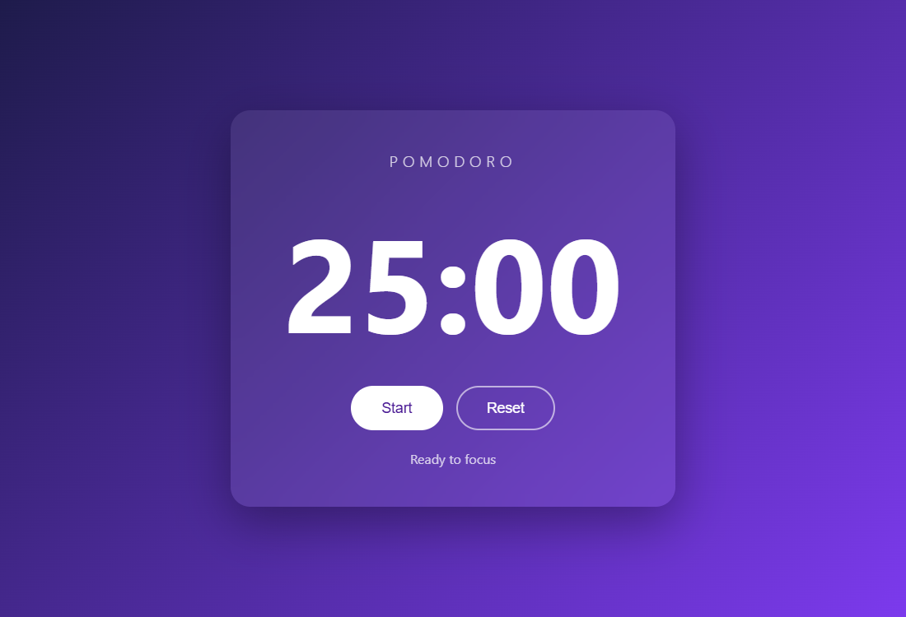
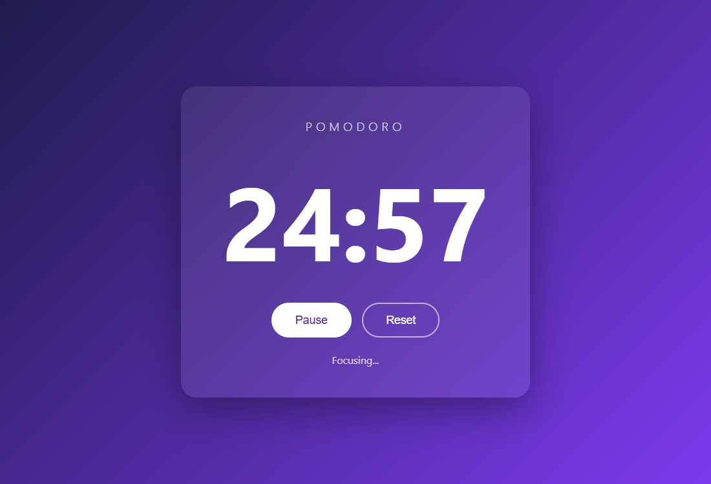
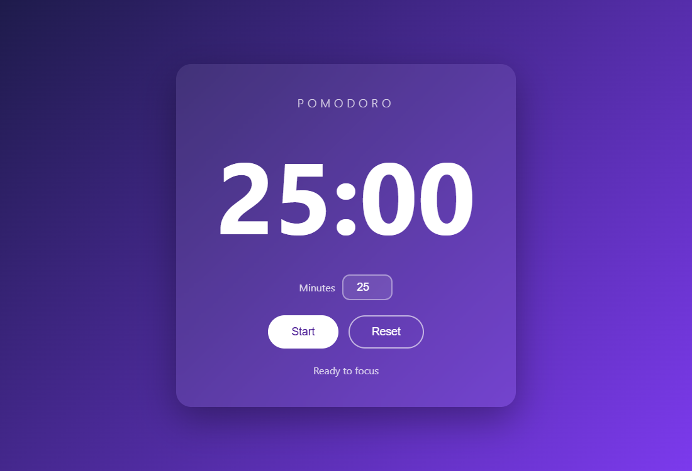
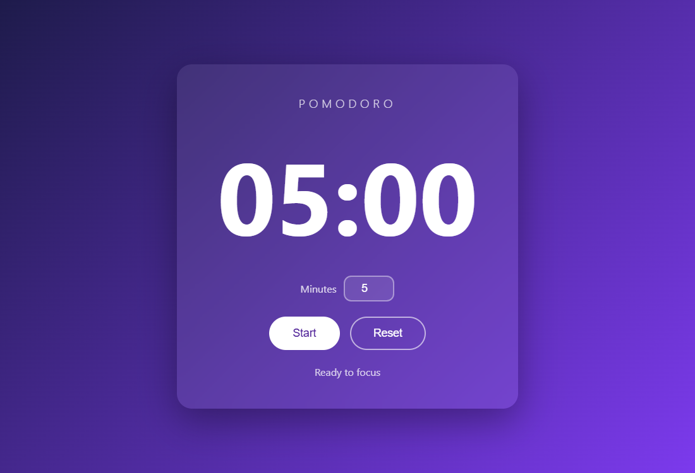
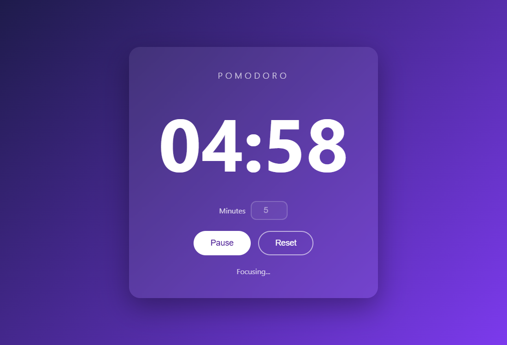
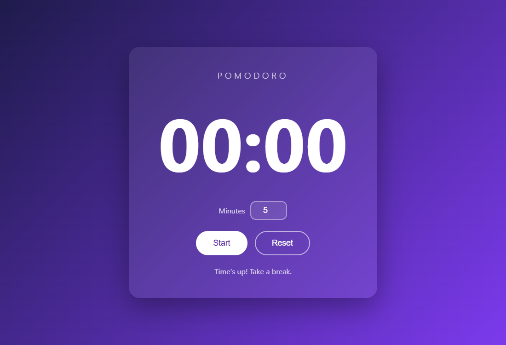

# Pomodoro Timer

A modern, web-based Pomodoro timer built with **HTML, CSS, and Vanilla JavaScript** (no frameworks or libraries). This was made using Google AntiGravity.

The Pomodoro Technique is a study/work method where you focus for a set block of time (traditionally 25 minutes), then take a short break. This app counts down that focus block and plays a sound when it's time for a break.

The project was built in two steps using AI prompts, and each step is saved in its own folder so you can see how the app evolved.

---

## Project structure

```
new/
├── prompt1/          Version 1: basic 25-minute timer
│   ├── index.html
│   ├── style.css
│   └── script.js
├── prompt2/          Version 2: adds custom time + sound effect
│   ├── index.html
│   ├── style.css
│   └── script.js
├── screenshots/      Images used in this README
└── README.md
```

| File | What it does |
| --- | --- |
| `index.html` | The structure of the page: title, timer display, buttons (and the minutes input in version 2). |
| `style.css` | The look: purple gradient background, frosted-glass card, large timer digits, rounded buttons. |
| `script.js` | The logic: counting down every second, Start/Pause/Reset buttons, and playing the sound at zero. |

---

## How to run it

1. Open the `prompt1` or `prompt2` folder.
2. Double-click `index.html`. It opens in your web browser.

No installation is needed. Node.js is not required to run the app.

---

## Version 1 (Prompt 1)

> *Create a modern web-based Pomodoro timer. It should have a large 25-minute countdown display and Start/Reset button. When the timer hits zero, play a notification sound. Use HTML, CSS, and Vanilla JavaScript.*

### Ready to start

When the page loads, the timer shows **25:00** in large digits. The message under the buttons says "Ready to focus".



### Running

Clicking **Start** begins the countdown, one second at a time. While it runs:

- The **Start** button changes to **Pause**, so you can stop and resume.
- The message changes to "Focusing...".
- The browser tab title also shows the remaining time, so you can see it from another tab.



### Buttons

- **Start / Pause**: starts the countdown, or pauses it if it's already running.
- **Reset**: stops the timer and puts it back to 25:00.

### When it hits zero

The timer stops, the message says "Time's up! Take a break.", and a **notification beep** plays.

---

## Version 2 (Prompt 2)

> *Update the code to add a sound effect when the timer hits zero. Also, add an input field in the HTML so the user can set a custom time in minutes.*

Version 2 keeps everything from version 1 and adds two features.

### New: custom time input

There's now a **Minutes** box under the timer. It starts at 25.



Type a different number (from 1 to 180) and the display updates right away. Here it's set to 5 minutes:



While the timer is running, the Minutes box is greyed out, so the time can't be changed by accident mid-session. Press **Pause** or **Reset** to change it again.



If someone types something invalid (empty, 0, or a negative number), the app corrects it to a valid value automatically.

### New: sound effect at zero

Instead of a single beep, version 2 plays a pleasant **three-note chime** (the notes C, E, G going up) when the timer reaches 00:00. The message changes to "Time's up! Take a break."



The sound is generated in code using the browser's built-in **Web Audio API**, so there's no audio file to download or lose.

---

## How the code works (simple explanation)

1. **Storing the time**: the script keeps a variable `remaining` that holds the number of seconds left (25 minutes = 1500 seconds).
2. **Counting down**: when you press Start, `setInterval` runs a function every 1000 milliseconds (1 second) that subtracts 1 from `remaining`.
3. **Showing the time**: the `formatTime` function turns seconds into `MM:SS` format (for example, 1497 seconds becomes `24:57`) and puts it on the page.
4. **Stopping at zero**: when `remaining` reaches 0, the interval is cleared (stopped) and the sound plays.
5. **Custom minutes (version 2)**: the value from the Minutes box is multiplied by 60 to get seconds, and that becomes the new starting time.

---

## Testing it quickly

Waiting 25 minutes to hear the sound takes too long. In version 2:

1. Set **Minutes** to `1`.
2. Press **Start**.
3. Wait one minute to see "Time's up!" and hear the chime.
